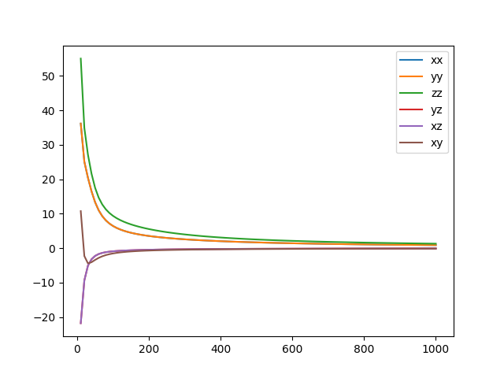
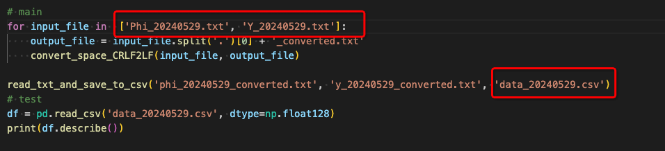
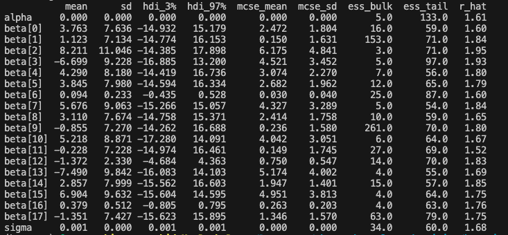

# Thermal Conductivity Project


## 项目介绍

本项目用于热导率计算与贝叶斯分析。部分输入文件因体积过大未上传至 GitHub：

- `graph18-compress0.pb`（未上传）
  
  如需该文件，请联系作者：zhenghuanhuan@zhejianglab.com

---

如果你正在查找论文 'On-the-fly machine learning-assisted high accuracy second-principles model for BaTiO3' 的相关代码，请参考 [Bilibili 视频](https://www.bilibili.com/video/BV1Xe48zREQR/) 了解如何使用本项目。

相关代码可在 [GitH pymc 分支](https://github.com/Tinrry/thermal_conductivity/tree/pymc) 获取。

---

If you are coming here for the code of 'On-the-fly machine learning-assisted high accuracy second-principles model for BaTiO3', please refer to [Bilibili](https://www.bilibili.com/video/BV1Xe48zREQR/) to know how to use the codes.

And the code related to that parper can be obtained via: [pymc branch](https://github.com/Tinrry/thermal_conductivity/tree/pymc)

---

## 快速开始

### 1. 热导率计算

运行以下命令，输出 `heat.txt`：

```bash
python workflow.py
```

### 2. 结果展示

基于 `heat.txt` 展示结果：

```bash
python heat-plot.py
```



---

## 运行流程说明

详细流程与说明请参考：[Notion 文档](https://www.notion.so/0632b5a9bf9f45d7945525d8d82211b2?pvs=4)

---

## 备注

- BZO 示例在 `mpirun` 下 `np=10`，共 517 个 case，约需 1 小时。
- 以下命令根据 `--mesh` 参数耗时不同：

  ```bash
  phono3py --fc3 --fc2 --dim="1 1 1" --mesh="11 11 11" --br --tmin=10 --tmax=1000 > Heat.txt &
  ```

---

## 贝叶斯实现（bayesian implement）

相关代码均放在 `bayesian` 目录下。

### 1. 数据格式转换

将 txt 文件转换为 csv：

```bash
python dataset.py
```



### 2. 使用 pymc3 实现贝叶斯分析

运行：

```bash
python lr_poly.py
```

